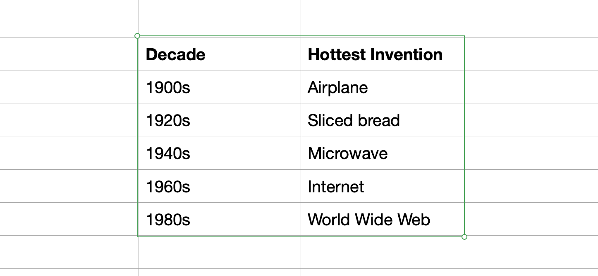

# How to copy paste a table to a dataframe in polars

read_clipboard

100DaysOfPolars

Author

Joram Mutenge

Published

2025-07-16

As a data professional, you’ll work with many Excel files, and most of them will be poorly formatted. This makes it difficult to read the file into a dataframe. Fortunately, there’s a way to copy only the rows and columns you want and turn them into a dataframe. You can run Polars code that instantly creates a dataframe from the contents of your clipboard. Below is a table copied from an Excel file.



table copied from Excel (actually Numbers)

## Paste to dataframe

To paste the table from your clipboard into a dataframe, use the expression `pl.read_clipboard`. It works like magic. Here’s how to do it:

``` python
import polars as pl

df = pl.read_clipboard()
df
```

shape: (5, 2)

| Decade  | Hottest Invention |
|---------|-------------------|
| str     | str               |
| "1900s" | "Airplane"        |
| "1920s" | "Sliced bread"    |
| "1940s" | "Microwave"       |
| "1960s" | "Internet"        |
| "1980s" | "World Wide Web"  |

And voilà! You have your dataframe.

Join 100+ students in the [Polars course](https://www.udemy.com/course/analyzing-data-with-polars-in-python/)!
