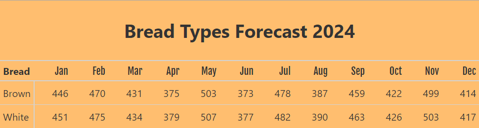
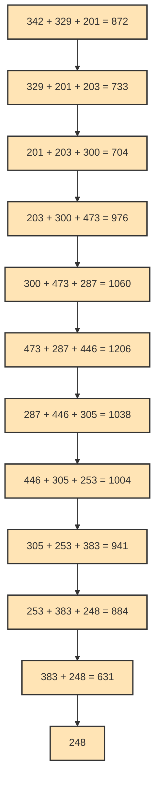

# How we helped a bakery generate forecast by bread type using polars

Author

Joram Mutenge

Published

2024-11-18

A few weeks ago, Conterval did a consulting gig for a medium-sized bakery. This bakery makes white and brown bread, which it sells to a major retail store here in the USA. The bakery contacted our company to help clean up their forecast data and generate a forecast for each bread type.

The gig turned out to be an interesting experience, so we asked the bakery if I could write about the experience on the company blog, and they said yes. In this post, I’ll share what the bakery’s problem was and the solution we devised to solve it.



final forecast output

## Problem

The bakery receives an Excel file with forecast data from a major US retail store every week. This file contains 2 columns: Date (the 1st of every month from January to December) and Forecast (the number of loaves of bread they want in that month).

The challenge was that the retail store did not provide a separate forecast value for white and brown bread. The retail store just provided a single forecast value. It was up to the bakery to divide that number into how many loaves of white or brown bread to make. It turns out this was a challenging task.

## Solution

Create a systematic process that determines how many loaves of bread should be made for each bread type based on the provided forecast value for that month. This information should be presented in an easy to understand table.

> **NOTE:**
>
> The generated table should be easy to update based on the new forecast data provided by the retail store.

## Dataset

We’ll not use the actual data from the bakery, rather we’ll use fictional data to demonstrate the solution. Here’s the baker’s sales data from last year.

shape: (24, 3)

| Date       | Bread   | Sales |
|------------|---------|-------|
| date       | str     | i64   |
| 2023-01-01 | "Brown" | 342   |
| 2023-01-01 | "White" | 203   |
| 2023-02-01 | "Brown" | 329   |
| 2023-02-01 | "White" | 304   |
| 2023-03-01 | "Brown" | 201   |
| …          | …       | …     |
| 2023-10-01 | "White" | 425   |
| 2023-11-01 | "Brown" | 383   |
| 2023-11-01 | "White" | 297   |
| 2023-12-01 | "Brown" | 248   |
| 2023-12-01 | "White" | 200   |

Here’s the forecast data from the retail store.

shape: (12, 2)

| Date       | Forecast |
|------------|----------|
| date       | i64      |
| 2024-01-01 | 897      |
| 2024-02-01 | 945      |
| 2024-03-01 | 865      |
| 2024-04-01 | 754      |
| 2024-05-01 | 1010     |
| …          | …        |
| 2024-08-01 | 777      |
| 2024-09-01 | 922      |
| 2024-10-01 | 848      |
| 2024-11-01 | 1002     |
| 2024-12-01 | 831      |

## The math

Determining how many brown or white loaves of bread to make was not as easy as dividing the forecast value by 2. Why? Because in some months, the retail store buys more white bread than brown bread. In other months, it’s the reverse.

We decided to leverage some timeseries calculations by doing a rolling sum with a 3-months window of last year’s sales by bread type. The idea was to get the weight or percentage for each bread type and use that to determine the number of loaves to make from the forecast value.

This math is quite involving, but it’s easy to follow along with the data.

## Implementing the math

Here are the formulas for calculating the rolling sum for the rows of each bread type.

\\\text{Row 1} = \text{Jan} + \text{Feb} + \text{Mar}\\

\\\text{Row 2} = \text{Feb} + \text{Mar} + \text{Apr}\\

\\\text{...}\\

\\\text{Second Last Row} = \text{Nov} + \text{Dec}\\

\\\text{Last Row} = \text{Dec}\\

And here is a visualization showing the calculated rolling sum values for each row of brown bread.



Now that we know what values to expect, we can implement the math. Initially, we thought that doing a `rolling_sum` polars function would perform the calculation shown above but it didn’t, at least not entirely.

Let’s demonstrate this calculation to see where it fell short.

``` python
(sales_df
 .filter(pl.col('Bread').eq('Brown'))
 .with_columns(Rol_3month=pl.col('Sales').rolling_sum(window_size=3))
 )
```

shape: (12, 4)

| Date       | Bread   | Sales | Rol_3month |
|------------|---------|-------|------------|
| date       | str     | i64   | i64        |
| 2023-01-01 | "Brown" | 342   | null       |
| 2023-02-01 | "Brown" | 329   | null       |
| 2023-03-01 | "Brown" | 201   | 872        |
| 2023-04-01 | "Brown" | 203   | 733        |
| 2023-05-01 | "Brown" | 300   | 704        |
| …          | …       | …     | …          |
| 2023-08-01 | "Brown" | 446   | 1206       |
| 2023-09-01 | "Brown" | 305   | 1038       |
| 2023-10-01 | "Brown" | 253   | 1004       |
| 2023-11-01 | "Brown" | 383   | 941        |
| 2023-12-01 | "Brown" | 248   | 884        |

This gives us some of the values we want, but it creates null values for the first 2 rows. To rectify the null value problem on the first two rows, we shifted the values in *Rol_3month* up by 2 rows.

``` python
(sales_df
 .filter(pl.col('Bread').eq('Brown'))
 .with_columns(Rol_3month=pl.col('Sales').rolling_sum(window_size=3))
 .with_columns(Rol_3month_Shift=pl.col('Sales').rolling_sum(window_size=3).shift(-2))
 )
```

shape: (12, 5)

| Date       | Bread   | Sales | Rol_3month | Rol_3month_Shift |
|------------|---------|-------|------------|------------------|
| date       | str     | i64   | i64        | i64              |
| 2023-01-01 | "Brown" | 342   | null       | 872              |
| 2023-02-01 | "Brown" | 329   | null       | 733              |
| 2023-03-01 | "Brown" | 201   | 872        | 704              |
| 2023-04-01 | "Brown" | 203   | 733        | 976              |
| 2023-05-01 | "Brown" | 300   | 704        | 1060             |
| …          | …       | …     | …          | …                |
| 2023-08-01 | "Brown" | 446   | 1206       | 1004             |
| 2023-09-01 | "Brown" | 305   | 1038       | 941              |
| 2023-10-01 | "Brown" | 253   | 1004       | 884              |
| 2023-11-01 | "Brown" | 383   | 941        | null             |
| 2023-12-01 | "Brown" | 248   | 884        | null             |

The problem of null values in the first 2 rows is solved, but another problem is created. The last 2 rows now have null values. At this point, we knew that `rolling_sum` wasn’t going to work.

The reason why rolling sum didn’t work is that on the first row, we don’t yet have 3 values to add so the sum is null, the same applies to the second row. But on the second row, we have 3 values in the window to add that’s why the first value shows up on row 3.

But since we wanted the value on row 3 to be on the first row, we shifted the values up by 2 rows, but that only created null values on the bottom two rows. Also, since the rolling sum shifts down one row to get the next 3 values, eventually there won’t be enough 3 values to add. That’s why we have null values.

However, from the formulas above, we see that if there are no 3 values to add, the rolling sum calculation proceeds by calculating the available values. So for the second to last row, it’s only 2 values (Nov + Dec), and for the last row, it’s only 1 value (Dec).

## Successful implementation of solution

The solution that worked involved the use of `implode`. Here’s how we implemented it. Let’s focus on brown bread only so we can see that the rolling sum values in the dataframe are the same as those in the visualization.

We’ll begin by creating a list of all the dates in the sales data.

``` python
date_list = sales_df['Date'].unique().to_list()
date_list
```

    [datetime.date(2023, 1, 1),
     datetime.date(2023, 2, 1),
     datetime.date(2023, 3, 1),
     datetime.date(2023, 4, 1),
     datetime.date(2023, 5, 1),
     datetime.date(2023, 6, 1),
     datetime.date(2023, 7, 1),
     datetime.date(2023, 8, 1),
     datetime.date(2023, 9, 1),
     datetime.date(2023, 10, 1),
     datetime.date(2023, 11, 1),
     datetime.date(2023, 12, 1)]

Now, let’s write some code to calculate the *Rol_3month* value for the first date in date_list. This date value will be accessed with 0 index as in `date_list[0]`.

``` python
(sales_df
 .filter(pl.col('Bread').eq('Brown'))
 .with_columns(Sales_List=pl.col('Sales').implode())
 .with_columns(Rol_3month=pl.col('Sales_List').list.slice(0, 3).list.sum())
 .filter(pl.col('Date').eq(date_list[0]))
)
```

shape: (1, 5)

| Date       | Bread   | Sales | Sales_List          | Rol_3month |
|------------|---------|-------|---------------------|------------|
| date       | str     | i64   | list\[i64\]         | i64        |
| 2023-01-01 | "Brown" | 342   | \[342, 329, … 248\] | 872        |

In the code above, we filtered the data to only show brown bread, then created a column *Sales_List* using `implode`. This stores all sales values from January to December into a single list. To calculate the `Rol_3month`, we slice the list of sales values to only select the first available 3 values and then add them up. Finally, we only get the row in the dataframe that corresponds to the chosen date, which is the first date in *date_list*.

Let’s reuse this code to calculate the *Rol_3month* value for white bread. Because we want to have a single dataframe showing the results for brown and white bread, we’ll use `vstack` to vertically combine the dataframes.

``` python
(sales_df
 .filter(pl.col('Bread').eq('Brown'))
 .with_columns(Sales_List=pl.col('Sales').implode())
 .with_columns(Rol_3month=pl.col('Sales_List').list.slice(0, 3).list.sum())
 .filter(pl.col('Date').eq(date_list[0]))
 .vstack(sales_df
 .filter(pl.col('Bread').eq('White'))
 .with_columns(Sales_List=pl.col('Sales').implode())
 .with_columns(Rol_3month=pl.col('Sales_List').list.slice(0, 3).list.sum())
 .filter(pl.col('Date').eq(date_list[0])))
)
```

shape: (2, 5)

| Date       | Bread   | Sales | Sales_List          | Rol_3month |
|------------|---------|-------|---------------------|------------|
| date       | str     | i64   | list\[i64\]         | i64        |
| 2023-01-01 | "Brown" | 342   | \[342, 329, … 248\] | 872        |
| 2023-01-01 | "White" | 203   | \[203, 304, … 200\] | 880        |

## Calculating percentages

Here’s the formula we used to calculate the percentage or weight for each bread type. Let’s focus on brown bread for the month of January.

\\\\ \text{ of Brown Bread} = \frac{\text{January Rol\\3month}}{\text{January Rol\\3month} + \text{White Bread January Rol\\3month}}\\

We are dividing each Rol_3month value for every bread type by the sum of the Rol_3month values for both bread types. Let’s put this into code. Also, we don’t need *Sales_List*, so we’ll drop it.

``` python
(sales_df
 .filter(pl.col('Bread').eq('Brown'))
 .with_columns(Sales_List=pl.col('Sales').implode())
 .with_columns(Rol_3month=pl.col('Sales_List').list.slice(0, 3).list.sum())
 .filter(pl.col('Date').eq(date_list[0]))
 .drop('Sales_List')
 .vstack(sales_df
 .filter(pl.col('Bread').eq('White'))
 .with_columns(Sales_List=pl.col('Sales').implode())
 .with_columns(Rol_3month=pl.col('Sales_List').list.slice(0, 3).list.sum())
 .filter(pl.col('Date').eq(date_list[0]))
 .drop('Sales_List'))
 .with_columns(Percentage=pl.col('Rol_3month') / pl.col('Rol_3month').sum())
 )
```

shape: (2, 5)

| Date       | Bread   | Sales | Rol_3month | Percentage |
|------------|---------|-------|------------|------------|
| date       | str     | i64   | i64        | f64        |
| 2023-01-01 | "Brown" | 342   | 872        | 0.497717   |
| 2023-01-01 | "White" | 203   | 880        | 0.502283   |

These are the values we want, but we’ve only calculated for the first date in date_list. We have to perform this calculation for every date in date_list. Rather than doing it manually 12 times, we’ll use a for loop to loop through the date_list.

It turns out that looping doesn’t work on a list of dates, so we’ll create a list of 12 numbers from 0 to 11. These numbers will be used as indices to represent each date item in date_list. Thus, to use the first date in the list, we use `date_list[0]`.

Let’s create a list of the numbers and store them in a variable called *num_list*.

``` python
num_list = list(range(len(date_list)))
num_list
```

    [0, 1, 2, 3, 4, 5, 6, 7, 8, 9, 10, 11]

Now let’s implement the for loop to get the desired dataframe.

``` python
pct_dfs = []
for i in num_list:
    pct_df = (sales_df
              .filter(pl.col('Bread').eq('Brown'))
              .with_columns(Sales_List=pl.col('Sales').implode())
              .with_columns(Rol_3month=pl.col('Sales_List').list.slice(0, 3).list.sum())
              .filter(pl.col('Date').eq(date_list[i]))
              .drop('Sales_List')
              .vstack(sales_df
              .filter(pl.col('Bread').eq('White'))
              .with_columns(Sales_List=pl.col('Sales').implode())
              .with_columns(Rol_3month=pl.col('Sales_List').list.slice(0, 3).list.sum())
              .filter(pl.col('Date').eq(date_list[i]))
              .drop('Sales_List'))
              .with_columns(Percentage=pl.col('Rol_3month') / pl.col('Rol_3month').sum())
              )
    pct_dfs.append(pct_df)
df_with_pct = pl.concat(pct_dfs)
df_with_pct
```

shape: (24, 5)

| Date       | Bread   | Sales | Rol_3month | Percentage |
|------------|---------|-------|------------|------------|
| date       | str     | i64   | i64        | f64        |
| 2023-01-01 | "Brown" | 342   | 872        | 0.497717   |
| 2023-01-01 | "White" | 203   | 880        | 0.502283   |
| 2023-02-01 | "Brown" | 329   | 872        | 0.497717   |
| 2023-02-01 | "White" | 304   | 880        | 0.502283   |
| 2023-03-01 | "Brown" | 201   | 872        | 0.497717   |
| …          | …       | …     | …          | …          |
| 2023-10-01 | "White" | 425   | 880        | 0.502283   |
| 2023-11-01 | "Brown" | 383   | 872        | 0.497717   |
| 2023-11-01 | "White" | 297   | 880        | 0.502283   |
| 2023-12-01 | "Brown" | 248   | 872        | 0.497717   |
| 2023-12-01 | "White" | 200   | 880        | 0.502283   |

## Joining forecast data

To get the forecast values for each bread type based on percentage values, we must join our dataframe with the forecast data provided by the retail store. We’ll join the dataframes on *Date* column.

> **NOTE:**
>
> Our sales data has the year 2023 while the forecast data has the year 2024. This means we won’t be able to join. We have to modify the dates so they match.

To make the dates in both dataframes match, we’ll remove the year in the date value. Below is the code that removes the year in the date value for the sales data.

``` python
(df_with_pct
 .with_columns(pl.col('Date').dt.strftime('%m-%d'))
)
```

shape: (24, 5)

| Date    | Bread   | Sales | Rol_3month | Percentage |
|---------|---------|-------|------------|------------|
| str     | str     | i64   | i64        | f64        |
| "01-01" | "Brown" | 342   | 872        | 0.497717   |
| "01-01" | "White" | 203   | 880        | 0.502283   |
| "02-01" | "Brown" | 329   | 872        | 0.497717   |
| "02-01" | "White" | 304   | 880        | 0.502283   |
| "03-01" | "Brown" | 201   | 872        | 0.497717   |
| …       | …       | …     | …          | …          |
| "10-01" | "White" | 425   | 880        | 0.502283   |
| "11-01" | "Brown" | 383   | 872        | 0.497717   |
| "11-01" | "White" | 297   | 880        | 0.502283   |
| "12-01" | "Brown" | 248   | 872        | 0.497717   |
| "12-01" | "White" | 200   | 880        | 0.502283   |

In the code below, we remove the year in the forecast data and join the two dataframes in a single dataframe called *combined_df*.

``` python
combined_df = (df_with_pct
 .with_columns(pl.col('Date').dt.strftime('%m-%d'))
 .join(forecast_df.with_columns(pl.col('Date').dt.strftime('%m-%d')),
       on='Date', how='left')
 )
combined_df
```

shape: (24, 6)

| Date    | Bread   | Sales | Rol_3month | Percentage | Forecast |
|---------|---------|-------|------------|------------|----------|
| str     | str     | i64   | i64        | f64        | i64      |
| "01-01" | "Brown" | 342   | 872        | 0.497717   | 897      |
| "01-01" | "White" | 203   | 880        | 0.502283   | 897      |
| "02-01" | "Brown" | 329   | 872        | 0.497717   | 945      |
| "02-01" | "White" | 304   | 880        | 0.502283   | 945      |
| "03-01" | "Brown" | 201   | 872        | 0.497717   | 865      |
| …       | …       | …     | …          | …          | …        |
| "10-01" | "White" | 425   | 880        | 0.502283   | 848      |
| "11-01" | "Brown" | 383   | 872        | 0.497717   | 1002     |
| "11-01" | "White" | 297   | 880        | 0.502283   | 1002     |
| "12-01" | "Brown" | 248   | 872        | 0.497717   | 831      |
| "12-01" | "White" | 200   | 880        | 0.502283   | 831      |

## Calculating new forecast

Now we have all the data needed to calculate the forecast for each bread type. All the forecast values are rounded to the nearest whole number. After all, you cannot make 1.67 loaves of bread!

``` python
new_fcst_df = (combined_df
 .with_columns(New_Forecast=(pl.col('Percentage') * pl.col('Forecast')).round().cast(pl.Int16))
 .with_columns(pl.col('Date').add(pl.lit('-2024')).str.strptime(pl.Date, "%m-%d-%Y"))
 )
new_fcst_df
```

shape: (24, 7)

| Date       | Bread   | Sales | Rol_3month | Percentage | Forecast | New_Forecast |
|------------|---------|-------|------------|------------|----------|--------------|
| date       | str     | i64   | i64        | f64        | i64      | i16          |
| 2024-01-01 | "Brown" | 342   | 872        | 0.497717   | 897      | 446          |
| 2024-01-01 | "White" | 203   | 880        | 0.502283   | 897      | 451          |
| 2024-02-01 | "Brown" | 329   | 872        | 0.497717   | 945      | 470          |
| 2024-02-01 | "White" | 304   | 880        | 0.502283   | 945      | 475          |
| 2024-03-01 | "Brown" | 201   | 872        | 0.497717   | 865      | 431          |
| …          | …       | …     | …          | …          | …        | …            |
| 2024-10-01 | "White" | 425   | 880        | 0.502283   | 848      | 426          |
| 2024-11-01 | "Brown" | 383   | 872        | 0.497717   | 1002     | 499          |
| 2024-11-01 | "White" | 297   | 880        | 0.502283   | 1002     | 503          |
| 2024-12-01 | "Brown" | 248   | 872        | 0.497717   | 831      | 414          |
| 2024-12-01 | "White" | 200   | 880        | 0.502283   | 831      | 417          |

## Final output

We now have the forecast values for each bread type, but we must present the data in a format that is not only human-readable but also easy to understand. We’ll select the relevant columns and transform the data into the desired format.

``` python
table_df = (new_fcst_df
 .select('Date','Bread','New_Forecast')
 .with_columns(pl.col('Date').dt.strftime('%b'))
 .pivot(on='Date', index='Bread')
 )
table_df
```

shape: (2, 13)

| Bread   | Jan | Feb | Mar | Apr | May | Jun | Jul | Aug | Sep | Oct | Nov | Dec |
|---------|-----|-----|-----|-----|-----|-----|-----|-----|-----|-----|-----|-----|
| str     | i16 | i16 | i16 | i16 | i16 | i16 | i16 | i16 | i16 | i16 | i16 | i16 |
| "Brown" | 446 | 470 | 431 | 375 | 503 | 373 | 478 | 387 | 459 | 422 | 499 | 414 |
| "White" | 451 | 475 | 434 | 379 | 507 | 377 | 482 | 390 | 463 | 426 | 503 | 417 |

This format is better, but since at Conterval we’re sticklers for aesthetics, we decided to make the final forecast output look even better. To do this, we used a library called `great-tables`.

``` python
from great_tables import GT, style, loc, google_font, html

month_list = table_df.columns[1:]
col_spacing = {month: '60px' for month in month_list}

(
    GT(table_df, rowname_col="Bread")
    .tab_stubhead(label=html('<b>Bread'))
    .tab_header(title=html("<h2>Bread Types Forecast 2024</h2>"))
    .tab_options(
        table_background_color='#ffbe6f',
        row_group_font_weight='bold',
        quarto_disable_processing=True
    )
    .tab_style(
        style=style.text(weight='bold', font=google_font(name="Fjalla One")),
        locations=loc.column_header()
    )
    .cols_width(cases=col_spacing)
)
```

[TABLE]

Contact us for help with your data problems. Also check out our [Polars course](https://www.udemy.com/course/analyzing-data-with-polars-in-python/) to level up your data analysis skills with this fast Python library.
