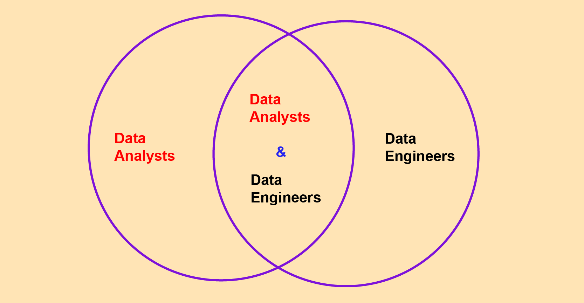
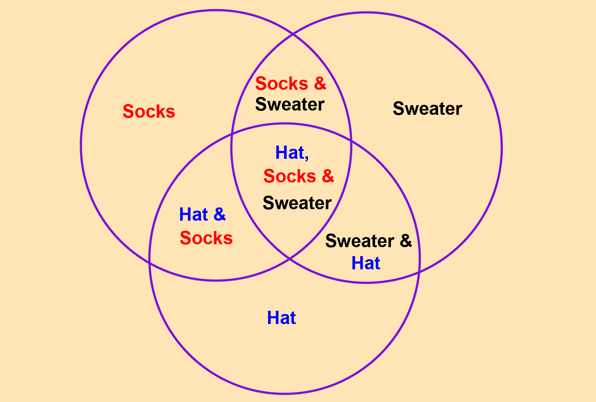

# Using set theory to speed up your data analysis

Author

Joram Mutenge

Published

2025-02-09

Most data analysis tasks involve joining tables to get more data or filter out specific data. But what happens when the data you’re working with isn’t in a format that allows easy table joins? In such cases, you can turn to sets. That’s right—the same sets you learned about in grade school can be incredibly useful for analyzing data. By applying your knowledge on set theory, you can effectively handle and analyze complex datasets.

## A refresher on sets

In case you’ve forgotten the fundamentals of set operations, allow me to bring you up to speed. First, let’s define what a set is:

- A set is a collection of zero or more items. Or, if you want to be more technical, a set is a collection of zero or more object references that point to hashable objects.\
- Sets are mutable, meaning you can add or remove items from them.\
- Sets are unordered, meaning they have no index positions and cannot be sliced like lists.

## Set operators

**Intersection**\
The intersection operation is one of the most commonly used in sets. It identifies and retrieves the elements that are shared across all the sets being compared. In Python, the symbol `&` is used for intersection. Suppose you had the following two sets.



sets of data analysts and engineers

``` python
data_engineers = set(['Jeremie', 'Joram', 'Ollie', 'Ashwin'])
data_analysts = set(['Joram', 'Ollie', 'Pallavi', 'Maura'])
```

Here’s how you would find out the people who are both data analysts and data engineers.

``` python
data_engineers & data_analysts
```

    {'Joram', 'Ollie'}

Now we see that Joram and Ollie are the superstars who can do both data analysis and data engineering.

**Union**\
The union operation gathers all the elements from both sets, ensuring that each element appears only once in the resulting set. The `|` symbol represents this operation. Using the union operator will give me all the names of data analysts and engineers.

``` python
data_engineers | data_analysts
```

    {'Ashwin', 'Jeremie', 'Joram', 'Maura', 'Ollie', 'Pallavi'}

**Difference**\
The difference operation identifies elements that exist in one set but not in the other. It is similar to subtraction in numbers. The symbol `-` represents this operation. The code below will give me names of people who are only data engineers.

``` python
data_engineers - data_analysts
```

    {'Ashwin', 'Jeremie'}

> **NOTE:**
>
> Set difference produces different results when the order is reversed. So, `A - B` is not the same as `B - A`.

``` python
data_analysts - data_engineers
```

    {'Maura', 'Pallavi'}

**Symmetric difference**\
This operation retrieves every element in set A and every element in set B, but excludes elements that are present in both sets. In short, it’s the subtraction of the intersection from the union set. The symbol `^` is used for set difference.

Here’s how I would get all the names of people who are only data analysts or data engineers. The superstars – those who can do both won’t be included.

``` python
data_analysts ^ data_engineers
```

    {'Ashwin', 'Jeremie', 'Maura', 'Pallavi'}

**Addition**\
This adds or inserts an element into the set. Let me display the set that contains data analysts.

``` python
data_analysts
```

    {'Joram', 'Maura', 'Ollie', 'Pallavi'}

Now let me add the name “David” to that set.

``` python
data_analysts.add('David')
data_analysts
```

    {'David', 'Joram', 'Maura', 'Ollie', 'Pallavi'}

## Analyze sales data

Now that your memory is refreshed on sets, let’s apply this knowledge to analyze real sales data. The sales data is stored in a CSV file, so I’ll use Python’s `csv` library to read it. To start, here’s how the data would look in Excel.

shape: (1_000, 8)

| Account Number | Account Name | sku | category | quantity | unit price | ext price | date |
|----|----|----|----|----|----|----|----|
| i64 | str | str | str | i64 | f64 | f64 | datetime\[μs\] |
| 803666 | "Fritsch-Glover" | "HX-24728" | "Hat" | 1 | 98.98 | 98.98 | 2014-09-28 11:56:02 |
| 64898 | "O'Conner Inc" | "LK-02338" | "Sweater" | 9 | 34.8 | 313.2 | 2014-04-24 16:51:22 |
| 423621 | "Beatty and Sons" | "ZC-07383" | "Sweater" | 12 | 60.24 | 722.88 | 2014-09-17 17:26:22 |
| 137865 | "Gleason, Bogisich and Franecki" | "QS-76400" | "Sweater" | 5 | 15.25 | 76.25 | 2014-01-30 07:34:02 |
| 435433 | "Morissette-Heathcote" | "RU-25060" | "Sweater" | 19 | 51.83 | 984.77 | 2014-08-24 06:18:12 |
| … | … | … | … | … | … | … | … |
| 29068 | "Brekke and Sons" | "FT-50146" | "Sweater" | 2 | 46.48 | 92.96 | 2014-08-10 16:20:32 |
| 77116 | "Lang-Wunsch" | "IC-59308" | "Socks" | 19 | 29.25 | 555.75 | 2013-11-20 13:32:45 |
| 23749 | "Bogisich and Sons" | "IC-59308" | "Socks" | 18 | 54.79 | 986.22 | 2014-03-10 08:11:59 |
| 172519 | "Kutch, Cormier and Harber" | "RU-25060" | "Sweater" | 15 | 62.53 | 937.95 | 2014-04-11 02:50:03 |
| 914594 | "Roberts, Volkman and Batz" | "LK-02338" | "Sweater" | 11 | 86.4 | 950.4 | 2014-02-14 20:10:42 |

**The task**\
The table above contains 1,000 sales transactions. Your task is to generate a sales report for your boss that answers the following questions:

- How many customers have bought socks?
- How many customers have bought hats?
- Who has bought socks but not hats?
- Which customers have bought socks, hats and sweaters?

Of course you can do this task in Excel by sorting and filtering your way to the report, but that’s time-consuming. I want to show you an efficient way to create the report that you can run month, weekly, even daily without having to redo the work.

**Creating the report**\
First let’s load the CSV file using the `csv` library.

``` python
import csv

sales_file = open(f"{Path('../../')}/datasets/sample_sales.csv", "rt")
reader = csv.reader(sales_file)
```

Now let’s create the empty sets for the three product categories contained the CSV file.

``` python
socks = set()
hats = set()
sweaters = set()
```

Finally, let’s creat the logic that will populate the sets we created with values.

``` python
for row in reader:
    customer = (row[0],row[1])
    category = row[3]
    if category == 'Socks':
        socks.add(customer)
    if category == 'Hat':
        hats.add(customer)
    if category == 'Sweater':
        sweaters.add(customer)

sales_file.close()
```

You’ve loaded the data and applied the logic to populate the sets representing the product categories. You can now answer the questions that your boss wants answered in the report.

Here’s how you would find the number of customes who bought socks.

``` python
len(socks)
```

    271

What about the number of customers who bough hats?

``` python
len(hats)
```

    170

You’re now confident that your code works, so it’s time to create the report. Below is a Venn diagram that highlights the key questions to address in the report.



venn diagram of product category sales

Here’s the full Python code you can run to create the report for you boss. It includes the names of customers who bought all three products. These are the valued customers.

``` python
import csv

# Using with open to automatically handle file closing
with open(f"{Path('../../')}/datasets/sample_sales.csv", "rt") as sales_file:
    reader = csv.reader(sales_file)

    # Initialize the sets
    socks = set()
    hats = set()
    sweaters = set()

    # Write the logic
    for row in reader:
        customer = (row[0], row[1])
        category = row[3]
        if category == 'Socks':
            socks.add(customer)
        if category == 'Hat':
            hats.add(customer)
        if category == 'Sweater':
            sweaters.add(customer)

# Print report results
print("SALES REPORT AS OF 2/2/25\n")
print(f'{len(socks)} customers bought socks.')
print(f'{len(socks - hats)} customers bought socks but not hats.')
print(f'{len(socks & hats)} customers bought socks and hats.')
print(f'{len(socks & sweaters)} customers bought socks and sweaters.')
print(f'{len(socks & hats & sweaters)} customers bought all three products.')

print(f'\nOur {len(socks & hats & sweaters)} valued customers are:')
for customer in (socks & hats & sweaters):
    print(f'  - {customer[1]}')
```

    SALES REPORT AS OF 2/2/25

    271 customers bought socks.
    240 customers bought socks but not hats.
    31 customers bought socks and hats.
    79 customers bought socks and sweaters.
    9 customers bought all three products.

    Our 9 valued customers are:
      - Beier-Bosco
      - Mills Inc
      - Ledner-Kling
      - Upton, Runolfsson and O'Reilly
      - Koepp-McLaughlin
      - Fritsch-Glover
      - Halvorson PLC
      - Bashirian, Beier and Watsica
      - Kuvalis-Roberts

Check out our [Polars course](https://www.udemy.com/course/analyzing-data-with-polars-in-python/) to upskill your data analysis skills.
