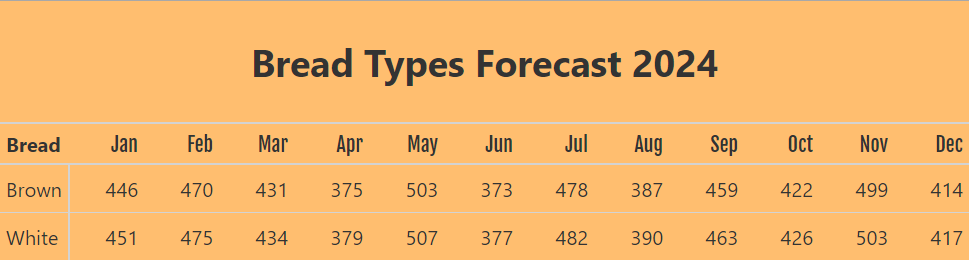

::: {.project-facts}
[Client: Medium-sized US bakery]{}
[Tools: Python, Polars, Great Tables]{}
:::

## The challenge

A medium-sized bakery supplies white and brown bread to a major US retail store. Every week, the store sends an Excel file with one forecast number for each month from January to December.

That number doesn't say how many loaves of each type to make. Splitting it evenly doesn't work, because in some months the store buys more white bread than brown, and in other months the reverse. The bakery was left to divide the number itself, and it asked Conterval to clean up the forecast data and produce a forecast for each bread type.

## The approach

We built a repeatable calculation based on the previous year's sales:

- **Weight each bread type.** A three-month rolling sum of each type's sales gives its share of demand for every month.
- **Handle the end of the year.** A standard rolling sum leaves empty values at the edges of the data. We calculated the windows from a list of the year's sales instead, so November uses two months and December uses one.
- **Apply the weights.** Each month's retailer forecast is multiplied by those shares and rounded to whole loaves.

## What was delivered

- A systematic process for splitting each monthly forecast by bread type
- A cleaned-up forecast joined to the prior year's sales
- An easy-to-read table showing loaves of each type by month, designed to be updated when new forecast data arrives

{fig-alt="Table of forecast loaves of brown and white bread for each month of 2024"}

## Read the full walkthrough

The blog post walks through the code step by step using fictional data, not the bakery's own figures: [How we helped a bakery generate forecast by bread type using polars](../../blog/helping-bakery-generate-forecast-by-bread-type-using-polars/index.qmd).
